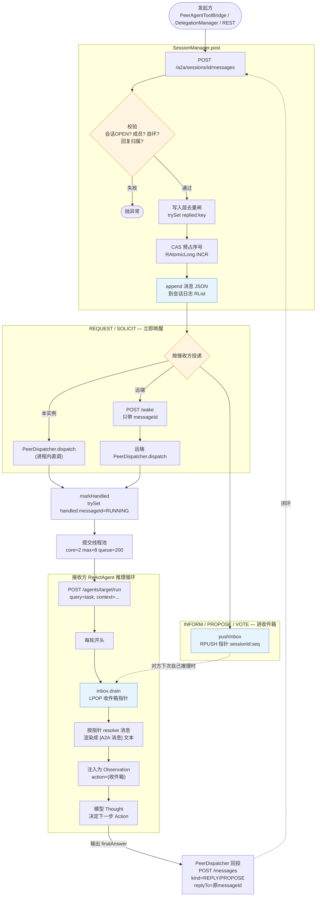

# 多 Agent 会话与消息传输

## 消息类型

**REQUEST**

由委派方发送，等一个执行结果，消息结构 `{task: "要做什么", depth: 委派链深度, context?: 业务上下文}`

会让接收方真的跑一遍自己的 ReAct 循环

**SOLICIT**

由协商召集人发送，等一个看法，消息结构 `{task, round, prior?}`

会让接收方真的跑一遍自己的 ReAct 循环

**REPLY**

被委派方的回复，消息体结构 `{agentId, success, answer, totalSteps, error}`

**PROPOSE**

由被征询方发送，和 REPLY 同结构，投票是从 answer 文本里二次解析出来的

**INFORM**    

任何成员都可以发送这类消息，自由结构

**VOTE（协议里预留了 VOTE，但当前版本协商表态统一走 PROPOSE）**

由协商参与者发送，对某个已提出的方案表态

协商召集人：召集人是这个会话协议里的一个占位身份，不是注册在 Agent 注册中心里的真 Agent。之所以需要它是因为协议里有一条规矩：每条消息的发送方必须是会话成员。但协商的发起方是工作流节点（或会话台前的人），它本身不是 Agent—— 没有 agentId、不会跑 LLM。可它必须在会话里，因为它要发征询（SOLICIT）、要收答案（PROPOSE）。于是给它一个约定名字放进成员表，绕过 "查注册表" 那套准入。

## 会话管理器——SessionManager

负责开会话、投递消息、读取、收尾

### persist

把会话和消息写进 Redis。

工作流程：校验、去重、预占序号、落盘、合并元数据。

```java
private A2aSession persist(String sessionId, A2aMessage message) {
    // 消息体不能为空
    if (message == null) {
        throw FlowAgentException.invalidParam("消息体不能为空");
    }
    A2aSession session = requireOpenSession(sessionId);

    String from = message.getFromAgentId();
    // 发送方不能为空
    if (from == null || from.isBlank()) {
        throw FlowAgentException.invalidParam("发送方 fromAgentId 不能为空");
    }
    // 发送方必须在会话成员里
    if (!session.hasMember(from)) {
        throw FlowAgentException.of("NOT_A_MEMBER",
                "发送方不在会话成员里: " + from, 403);
    }
    String to = message.getToAgentId();
    if (to != null) {
        // 自环检查
        // 正常链路不会自转，这个检查是防御性的 —— 配置错了或者代码有 bug 时，及时拦下
        if (to.equals(from)) {
            throw FlowAgentException.of("SESSION_LOOP",
                    "接收方就是发送方自身，会形成自环: " + from, 409);
        }
        // 接收方必须在会话成员里
        if (!session.hasMember(to)) {
            throw FlowAgentException.of("NOT_A_MEMBER",
                    "接收方不在会话成员里: " + to, 403);
        }
    }

    fillDefaults(message, sessionId);

    // replyTo 与 fromAgentId 都是请求体自填的
    // 没有这道检查，B 可以提交一条 replyTo 指向「发给 A 的请求」的回复，在会话日志里冒充 A 的表态。
    if (message.getReplyTo() != null && !message.getReplyTo().isBlank()) {
        try {
            store.findMessage(sessionId, message.getReplyTo()).ifPresent(original -> {
                String expected = original.getToAgentId();
                if (expected != null && !expected.isBlank() && !expected.equals(from)) {
                    throw FlowAgentException.of("REPLY_ATTRIBUTION_MISMATCH",
                            "回复方 " + from + " 不是原消息的接收方 " + expected, 403);
                }
            });
        } catch (FlowAgentException e) {
            throw e;
        } catch (RuntimeException e) {
            // fail-open：读不到原消息不能变成「回复写不进去」
            log.warn("[A2A] 读取被回复消息失败，跳过归属校验 | session={} | replyTo={} | error={}",
                    sessionId, message.getReplyTo(), e.toString());
        }
    }

    // 这条消息要不要做去重保护
    // 只有回复类消息要做去重保护（因为同一个问题应该只有一个答案）
    boolean guardable = message.getReplyTo() != null && !message.getReplyTo().isBlank()
            && REPLY_DEDUPE_KINDS.contains(message.getKind());
    // 有没有抢到幂等槽
    boolean claimed = false;
    if (guardable) {
        try {
            // 抢锁
            A2aMessage winner = store.claimReply(message);
            // 抢锁失败返回赢家信息
            if (winner != null) {
                // 不落盘、不投递，把先到的那条原样返回
                // 调用方拿到的仍然是一个带 messageId 与 seq 的真实消息，只是它不是它刚提交的那一份
                long n = replyDuplicatesSkipped.incrementAndGet();
                log.warn("[A2A] 重复回复已拦下，返回先到的那条 | session={} | from={} | replyTo={} | 累计 {} 条",
                        sessionId, message.getFromAgentId(), message.getReplyTo(), n);
                throw new DuplicateReply(winner);
            }
            claimed = true;
        } catch (DuplicateReply duplicate) {
            // 重复回复异常
            throw duplicate;
        } catch (Exception e) {
            // fail-open 降级——Redis 抖动时，锁抢不到，系统不阻塞写入，直接放行
            long n = replyGuardFailures.incrementAndGet();
            // 日志留痕
            if (n == 1 || n % 100 == 0) {
                // 计数逐次，日志限流
                log.warn("[A2A] 回复去重闸读不到，本次放行不做去重 | 累计 {} 次 | session={} | replyTo={} | error={}",
                        n, sessionId, message.getReplyTo(), e.toString());
            }
        }
    }

    long reserved = -1L;
    // seq>0 说明已经预置过序号了不过 append 还没有执行进程就崩了
    if (message.getSeq() <= 0) {
        // 预占
        reserved = store.reserveSeq(sessionId, messageBudget);
        // 返回 -1，说明超过消息预算
        if (reserved < 0) {
            if (claimed) {
                // 释放锁
                releaseQuietly(message);
            }
            throw FlowAgentException.of("MESSAGE_BUDGET_EXCEEDED",
                    "会话 " + sessionId + " 已达消息预算 " + messageBudget + " 条", 429);
        }
        // 给内存里的java对象 setSeq
        message.setSeq(reserved);
    }

    long seq;
    try {
        seq = store.append(message);
    } catch (RuntimeException e) {
        // 为什么 try 只包住 append
        // 消息一旦写进 Redis，就算后续唤醒对端失败，也不能回滚序号和锁
        // 因为消息已经在日志里了，回滚了就等于允许再写一遍，会造成重复
        if (reserved > 0) {
            // 预占了序号要回滚
            rollbackQuietly(sessionId, reserved);
        }
        if (claimed) {
            releaseQuietly(message);
        }
        throw e;
    }
    if (claimed) {
        // 给 Redis 上存的信息补上 seq
        refreshQuietly(message);
    }
    
    signalReply(sessionId, message);
    session.setMessageCount((int) seq);
    session.setUpdatedAt(Instant.now());
    store.updateAfterAppend(session);
    return session;
}
```

首先确认消息体、发送方不能为空，且发送方必须在会话成员里

备注：**Redis 是跨进程的，它存不了 Java 对象**

## 会话存储——SessionStore


## 对端分发器——PeerDispatcher

## 委派管理——DelegationManager

## 设计细节

### "共同会话 + 单独收件箱" 具体指的是什么？

共同会话=共享一份消息日志

一个会话在 Redis 里是三个 key：

a2a:session:{sessionId}    ← 元数据（成员表、状态、topic）

a2a:msgs:{sessionId}       ← 消息日志（所有消息按 seq 排的 List）

a2a:seq:{sessionId}        ← 序号计数器

"共同" 的意思是：这个会话里所有成员发的每一条消息（REQUEST、REPLY、PROPOSE、INFORM…），都 append 到同一个 a2a:msgs:{sessionId} 列表里，按 seq 递增排序。任何成员都能调 GET /a2a/sessions/{id}/messages?after=N 读到这份日志，不管是发给谁的。

收件箱 = Agent 的 "未读通知栏"

a2a:inbox:{agentId}        ← RQueue，里面放的是 "sessionId:seq" 指针

"单独" 的意思是：消息落盘后，`SessionManager.deliver` 会判断这条消息的接收方是谁，往那个 Agent 的 inbox 里放一条指针 `sessionId:seq`。

Agent 在跑自己的 ReAct 循环时，每轮开头做一件事：从自己的 inbox 里 poll 出指针，按 `sessionId:seq` 去共享消息日志里把这条消息捞出来，注入到本轮上下文里。

两层的分工是：会话日志管 "消息的持久化和共享历史"，收件箱管 "每个 Agent 各自的消息"。消息本体只写一份（会话日志），收件箱里只是指针

### 收件箱里为什么只存储 INFORM/PROPOSE/VOTE，REQUEST、REPLY、SOLICIT 都不在里面

首先要明白收件箱的作用：多 Agent 协作时，一个 Agent 正在跑自己的推理循环，这时候别人给它发了消息 —— 如果直接打断它，它正在做的事就乱了；如果完全不管，消息又永远没人看。收件箱就是Agent 的 "未读消息通知栏"—— 别人发的通知先放在这里，Agent 每轮推理开头看一眼，拼进上下文里自己决定要不要回应（对话是通过新委派完成的，如果没有注册对应 Agent 为当前 Agent 的工具就不可能回应）。它不打断当前工作、不保证一定被处理，但保证消息不丢。

之所以不放 REQUEST、REPLY、SOLICIT 是因为:

REQUEST 是委派执行，是一定要执行的；SOLICIT 是征求意见，也是必须要回复的。REPLY 的消费方不是 Agent 的推理循环（收件箱是给 Agent 的 ReAct 循环用的，每轮推理前拼进上下文），是发 REQUEST 的 Agent 在轮询，它是从会话日志里 readAfter 拉取的，而不是靠收件箱

### 消息从发出到被另一个 Agent 收到，走了哪几步？



### "各 Agent 唤醒互不打扰"——具体指什么？两个 Agent 同时给同一个 Agent 发消息，它会怎么处理？

不同会话、不同 messageId 的 REQUEST，各走各的执行通道，不互相阻塞、不共享上下文。

两个 Agent 同时给 B 发消息。B 收到两个 wake，`dispatch` 被调两次，由于 `markHandled` 的键是 `messageId`，msg1 和 msg2 是不同 UUID，两个都能抢到，不互相排队。线程并行跑，两次 `runAgent` 是两个独立的 HTTP 调用，B 的 Agent 服务端各自创建独立的 ReAct 上下文 —— 各自有自己的步数预算、工具调用历史、Final Answer。

互不打扰具体指：

1.执行权不互抢，2.推理上下文不共享，3.结果回投不串

### seq 是怎么分配的？为什么用 Redis 的原子计数器，不用数据库自增或者 UUID？

```java
// 没有直接使用 INCR，因为要做消息预算。
// 如果直接 INCR，N 个并发请求同时读到 current=budget-1，全部判定 "还没到预算"，各自 INCR—— 预算被击穿。
for (int attempt = 0; attempt < 64; attempt++) {
    long current = counter.get();
    if (current >= budget) return -1;      // 超预算
    if (counter.compareAndSet(current, current + 1)) {
        counter.expire(ttl());
        return current + 1;
    }
}

// 写消息日志失败要回滚
// 不是直接 DECR—— 因为并发下别的消息可能已经在这个值之后又占了号
// 如果发现别人已经占了号(CAS失败了)，就放弃回收，回收失败的号就对应一个空消息
counter.compareAndSet(seq, seq - 1);
```

seq 的本质是会话内的单调递增游标，不是全局唯一 ID。数据库自增太重；UUID 无序、做不了增量拉取。选 RAtomicLong 是因为它正好匹配 "会话内单调递增 + 增量游标 + 消息预算" 这三个需求，没有额外存储成本。

### 序号中间断了一个怎么办？比如 seq=3 写失败了，消费方拉到 seq=1,2,4 会怎么处理？

seq 加一成功但是 append 失败，序号被消耗了但是消息没写进去，会先回滚，回滚失败才会出现序号中断了一个的情况（但是 append 失败就失败了，因为这段时间 Redis 都在抖动，干脆直接失败），不会有问题，既不会产生重读也不会漏

### 做了消息幂等，那重复消息是怎么来的？为什么会重复？

你发了一个网络请求，你永远不知道对方是没收到、还是收到了但响应没回来。 重试是兜底，但重试就可能导致对方收到两次。两道幂等闸就是为了让 "收到两次" 只执行一次、只写一次。

### 幂等靠什么判重？去重键是什么？键的粒度怎么定的？

两层去重，键得粒度不同：

1.claimReply(回复去重)——四段键 `a2a:replied:{sessionId}:{fromAgentId}:{replyTo}:{payload摘要}
`

sessionId：不同会话

fromAgentId：同一个 Agent 对同一个请求的回复才算重复

replyTo：回复的是哪条请求

payload 摘要：同一个 Agent 对同一个请求改口

2.markHandled(执行去重)——单键 `a2a:handled:{messageId}
`，是在执行之前"抢锁"，成功了就继续执行

### 判重的那个存储挂了怎么办？Redis 不可用的时候，是放行还是拒绝？

claimReply 和 markHandled 两层都是 fail-open：

claimReply——计数留痕，本次放行，不做去重

Agent 跑完了 ReAct 循环、生成了回复、提交 REPLY 到 Gateway——这时候 Agent 已经跑完了，回复已经生成了。重复提交只是 "同一份结果被 post 了两次"，不会多跑一次 Agent、不会多烧一次 token。重复的代价是：消息日志里多了一条内容几乎一样的 REPLY，messageId 不同、seq 不同。

消费端是怎么处理重复的 REPLY 的：读的过程中判断 `isReplyTo(message, messageId)`，如果消息回复的是我的 messageId 就直接返回不再继续读了，因此这个重复对消费端没有影响

那万一有多条不同的消息 replyTo 都是当前 messageId 呢，不就漏了吗——有执行层幂等闸、写入层去重闸，理论上不会出现假设的这种情况

markHandled——"拿不到闸门就不干活"会让一次 Redis 抖动变成一堆永远不执行的委派（所有正在派发的 REQUEST 都 markHandled 失败，所有正在轮询等 REPLY 的发起方都同时超时），并且旧的 REQUEST 不会再被唤醒

### 幂等存多久？为什么是这个时长？

claimReply：与会话同生命周期

回复去重的目的是防 "同一个请求被重复回复"。会话结束后这个请求就没人再回了，去重槽跟着会话一起过期。

markHandled：600s

执行去重的目的是防 "同一条 REQUEST 被执行两次"。一次 Agent 执行的最长时间就是 `dispatchTimeoutSeconds`。

TTL 必须大于一次执行的最长耗时：如果 TTL 太短，Agent 还在跑，键就过期了，重投过来会重新执行一遍。10 分钟是 "一次执行 + 可能的重投窗口" 的上界。

为什么不存更长时间：防止 Redis 里堆积大量 `a2a:handled:{messageId}` 键，浪费内存

### 委派 Agent 怎么等待委派结果

A 给 B 发了任务，A 不是一直盯着，而是每个 500ms readAfter 一次："会话里有没有新消息"，期间维护一个数避免每次都从头开始读，遇到期待的消息就返回（replyTo 就是我发的那条 REQUEST 的 messageId）

之所以不采用回调是因为开发时不能互相 import 对方的类
